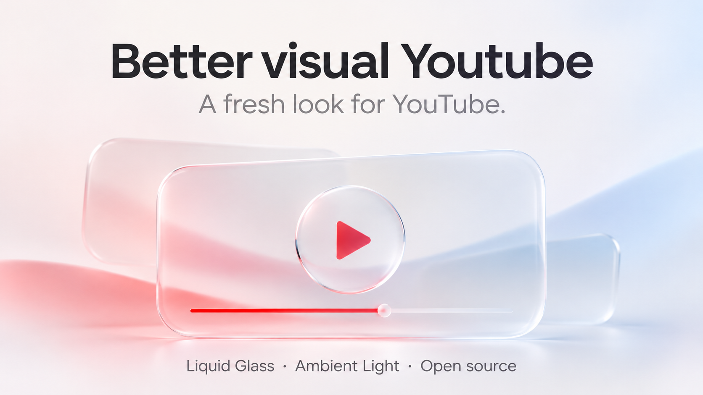
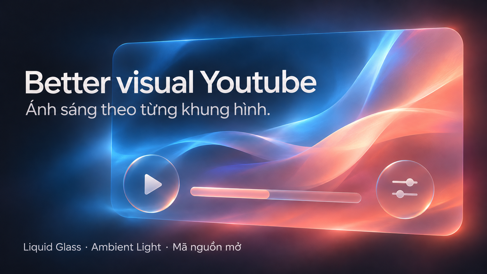

# Better visual Youtube

Thêm một diện mạo mới cho YouTube với lớp kính trong, ánh sáng theo video và chuyển động trên giao diện.

**[Tải bản mới nhất](https://github.com/Moments2505/better-visual-youtube/releases/latest)** · [Changelog](CHANGELOG.md) · [English](README.md) · [Báo lỗi](https://github.com/Moments2505/better-visual-youtube/issues)

Tiện ích miễn phí, mã nguồn mở, dành cho Microsoft Edge và Google Chrome trên máy tính.

**Bản chính thức mới nhất: [0.5.0](https://github.com/Moments2505/better-visual-youtube/releases/tag/v0.5.0).** Bổ sung Cấu hình nhanh 1 chạm, đồng bộ cài đặt & Xuất/Nhập JSON, giao diện song ngữ Anh/Việt gốc, liền mạch kính nền trời và giảm 70% dung lượng gói MV3. [Chi tiết phiên bản](https://github.com/Moments2505/better-visual-youtube/blob/main/docs/releases/v0.5.0.md)

## Thêm chiều sâu cho giao diện

Liquid Glass mang lớp kính trong và viền bắt sáng đến thanh đầu trang, ô tìm kiếm, bộ điều khiển video và các khung nội dung. Bạn có thể chỉnh màu kính, độ mờ, độ trong và phản sáng theo sở thích.

## Ánh sáng theo từng khung hình

Ambient Light mở rộng màu sắc từ video ra xung quanh trình phát. Độ lan, độ sáng và chất lượng đều có thể điều chỉnh ngay trong bảng cài đặt của tiện ích.



## Tuỳ chỉnh theo cách bạn thích

**Follow system reduced motion** mặc định bật. Nếu trình duyệt báo giảm chuyển động ngoài ý muốn, bỏ chọn mục này trong popup, rồi bật **Motion effects** và **Ambient Light** theo nhu cầu. **Animate sky** vẫn có công tắc riêng. Tùy chọn này không thay đổi cài đặt Windows hay trình duyệt.

Chọn giao diện sáng hoặc tối, tinh chỉnh hiệu ứng kính và bật tắt các chuyển động. Các lựa chọn được lưu ngay trong trình duyệt của bạn.

**Opacity** điều chỉnh độ đục của headbar và panel nội dung cùng nhau. Ở 0%, kính trong suốt; vùng cao khoảng 70–100% chuyển dần từ màu tint đã chọn sang trắng, đạt trắng đặc ở 100% với chữ nội dung tối. Bước 99–100% chuyển tiếp nhẹ, không đổi màu đột ngột.

Mục **Time-of-day background** thêm nắng sớm, trời ban ngày, hoàng hôn hoặc bầu trời sao có mặt trăng cho Trang chủ, Tìm kiếm và trang kênh. Auto theo mặt trời tại thành phố đã chọn, mặc định là London, United Kingdom; bạn cũng có thể chọn cảnh thủ công. **Animate sky** điều khiển chuyển động nền riêng với **Motion effects** của giao diện; Ambient Light cũng có công tắc riêng.

Nền procedural thay đổi ánh sáng, sắc hoàng hôn và cấu trúc mây theo thời gian, dừng khi tab ẩn và dùng cảnh CSS dự phòng nếu WebGL không hoạt động. Tắt **Animate sky** để giữ cảnh đứng yên; cảnh vẫn có thể cập nhật khi mặt trời hoặc thời tiết đổi. Headbar dùng chung cài đặt Opacity với panel; preview Trang chủ khớp với thumbnail.

Muốn có không khí trời mưa, bật **RAIN** trong **Time-of-day background**. Mưa lớn, trời âm u và giọt nước bám trên kính xuất hiện ở Trang chủ/Tìm kiếm/trang kênh trong mọi cảnh, không cần bật Live weather hay cấp quyền kết nối. **Animate sky** điều khiển chuyển động mưa. Lựa chọn được lưu; hiệu ứng chỉ có hình ảnh, giữ nguyên âm thanh nhạc/video. Tắt RAIN sẽ dừng mưa và nước bám kính, cả khi Live weather báo mưa; ánh sáng mặt trời và dữ liệu thời tiết vẫn cập nhật.

Để thêm thời tiết, bật **Time-of-day background**, chọn **Auto**, rồi bật **Live sun & weather**. Dùng **Choose a city** để đổi thành phố. Trình duyệt hỏi quyền kết nối Open-Meteo cho thời tiết và tìm thành phố; dùng **Allow weather access** nếu còn thiếu quyền. Tọa độ thành phố đã chọn hoặc nội dung tìm thành phố được gửi tới Open-Meteo; tiện ích không xin GPS. Ánh sáng mặt trời tính được khi mất mạng. Thời tiết thường cập nhật mỗi 15 phút, dùng dữ liệu đệm tối đa hai giờ khi yêu cầu mới thất bại. [Chi tiết quyền riêng tư](docs/PRIVACY-VI.md)

Dữ liệu thời tiết: [Open-Meteo](https://open-meteo.com/), [CC BY 4.0](https://creativecommons.org/licenses/by/4.0/).

## Cài đặt

1. Tải gói ZIP của tiện ích trong [Releases](https://github.com/Moments2505/better-visual-youtube/releases), rồi giải nén.
2. Mở `edge://extensions` hoặc `chrome://extensions` và bật **Chế độ nhà phát triển**.
3. Chọn **Tải tiện ích đã giải nén**, rồi chọn thư mục chứa `manifest.json`.
4. Tải lại YouTube và mở tiện ích để chọn hiệu ứng bạn thích.

[Hướng dẫn cài đặt](INSTALL-VI.md) · [Installation guide](INSTALL-EN.md)

**Cập nhật bản đang dùng:** giải nén ZIP mới đè lên các tệp trong cùng thư mục extension, bấm **Reload / Tải lại** trên trang tiện ích rồi tải lại YouTube. Giữ bản cài hiện tại để giữ các lựa chọn đã lưu. Quyền thời tiết tùy chọn chỉ được hỏi khi bạn sử dụng thời tiết hoặc tìm thành phố.

Nếu gặp lỗi hoặc có ý tưởng mới, bạn có thể [tạo issue](https://github.com/Moments2505/better-visual-youtube/issues).

## Cùng phát triển

Dự án mở mã nguồn theo [giấy phép MIT](LICENSE). Có thể nạp trực tiếp thư mục repo vào trình duyệt, không cần build.

Để chạy kiểm thử và đóng gói ZIP phát hành, dùng Node.js 22+:

```sh
node scripts/check.js
node scripts/package-release.js
```

Xem [hướng dẫn đóng góp](CONTRIBUTING.md) để tìm hiểu cấu trúc mã nguồn.

## Ghi nhận

Phát triển bởi **Team Visualism**. Ambient Light sử dụng mã đã chỉnh sửa từ [youtube-ambilight](https://github.com/WesselKroos/youtube-ambilight) của Wessel Kroos, theo giấy phép MIT. Hiệu ứng kính tham khảo [bài viết về khúc xạ bằng CSS/SVG](https://kube.io/blog/liquid-glass-css-svg/). Thông tin chi tiết có trong [ghi nhận bên thứ ba](THIRD-PARTY-NOTICES.md).

[Chính sách quyền riêng tư](docs/PRIVACY-VI.md) · [Privacy policy](docs/PRIVACY-EN.md) · [Liên hệ](mailto:quannguyenproducer2505@gmail.com)

Đây là dự án độc lập, không liên kết với YouTube, Google, Apple hay Microsoft.
