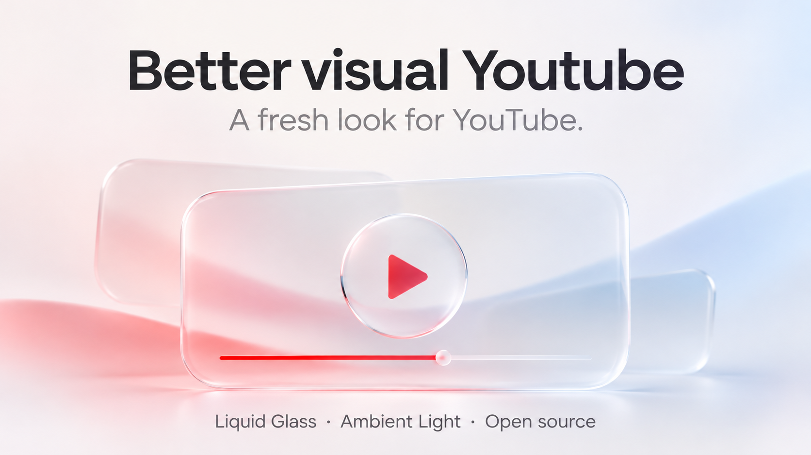

# Better visual Youtube

A fresh look for YouTube, with transparent glass surfaces, colour that follows your video, and animations throughout the interface.

**[Download beta](https://github.com/Moments2505/better-visual-youtube/releases)** · [Changelog](CHANGELOG.md) · [Tiếng Việt](README-VI.md) · [Report an issue](https://github.com/Moments2505/better-visual-youtube/issues)

Made for desktop Microsoft Edge and Google Chrome. Currently in beta, with more refinements to come.

**Latest beta: [0.4.63](https://github.com/Moments2505/better-visual-youtube/releases/tag/v0.4.63).** Adds an optional sky and city weather, keeps Ambient Light independent of interface motion, and fixes the transparent header and misaligned Home hover previews when the sky is enabled. [Release notes](https://github.com/Moments2505/better-visual-youtube/blob/v0.4.63/docs/releases/v0.4.63.md)

## A little more depth

Liquid Glass brings transparent surfaces and light-catching edges to the header, search box, player controls and content panels. Adjust the tint, blur, opacity and reflections to suit your screen.

## Light that follows the video

Ambient Light extends colours beyond the player. Choose how far the light spreads and how bright it feels, with quality controls in the same settings panel.


## Make it yours

Choose a light or dark theme, tune the glass effects, and turn interface animations on or off. Your preferences are saved in your browser.

The optional **Time-of-day background** adds morning sunlight, a daytime sky, sunset or a moonlit star field to Home and Search. Auto follows the sun at your chosen city, initially Hà Nội. You can also choose a scene manually. **Animate sky** controls sky movement separately from interface **Motion effects**; Ambient Light has its own switch too.

The procedural sky changes sunlight, twilight colour and cloud structure over time. It pauses while the tab is hidden and falls back to a CSS scene if WebGL is unavailable. Turn **Animate sky** off for a still atmosphere; the scene can still update as the sun or weather changes. With the sky enabled, the header retains a readable glass surface even at panel Opacity 0, and Home hover previews stay aligned with their thumbnails.

To add weather, turn on **Time-of-day background**, select **Auto**, then enable **Live sun & weather**. Use **Choose a city** to change the location. The browser asks for optional Open-Meteo access for weather and city search; use **Allow weather access** if permission is missing. Your chosen city coordinates or city-search text go to Open-Meteo; the extension does not request GPS. Solar lighting works offline. Weather normally refreshes every 15 minutes, with cached fallback for up to two hours when fetching fails. [Privacy details](docs/PRIVACY-EN.md)

These are decorative scenes, not a live camera or a precise astronomical map. The sky uses a bounded canvas and at most 20 background updates per second; this is a workload limit, not a 120 FPS claim. Weather data: [Open-Meteo](https://open-meteo.com/), [CC BY 4.0](https://creativecommons.org/licenses/by/4.0/).

## Get started

1. Download the extension ZIP from [Releases](https://github.com/Moments2505/better-visual-youtube/releases) and extract it.
2. Open `edge://extensions` or `chrome://extensions` and turn on **Developer mode**.
3. Select **Load unpacked**, then choose the folder containing `manifest.json`.
4. Reload YouTube and open the extension to explore the settings.

[English installation guide](INSTALL-EN.md) · [Hướng dẫn cài đặt tiếng Việt](INSTALL-VI.md)

**Updating an existing installation:** extract the new ZIP over the files in the same extension folder, click **Reload** on the extensions page, then reload YouTube. Keep the existing installation to retain its saved preferences. Optional weather access is requested only when you use weather or city search.

Found a bug or have an idea? [Open an issue](https://github.com/Moments2505/better-visual-youtube/issues).

## Build with us

The source is open under the [MIT license](LICENSE). You can load this repository directly as an unpacked extension; no build step is needed.

To run the source checks and create a ZIP, use Node.js 22+ and Python 3.12+:

```sh
python scripts/check.py
python scripts/package-release.py --output-dir dist
```

See [Contributing](CONTRIBUTING.md) for the source layout and development notes.

## Credits

Created by **QuanNguyen**. Ambient Light includes modified code from [youtube-ambilight](https://github.com/WesselKroos/youtube-ambilight) by Wessel Kroos, used under MIT. The glass effects draw on [this CSS/SVG refraction article](https://kube.io/blog/liquid-glass-css-svg/). See [Third-party notices](THIRD-PARTY-NOTICES.md) for details.

[Privacy policy](docs/PRIVACY-EN.md) · [Chính sách quyền riêng tư](docs/PRIVACY-VI.md) · [Contact](mailto:quannguyenproducer2505@gmail.com)

An independent project, unaffiliated with YouTube, Google, Apple or Microsoft.
