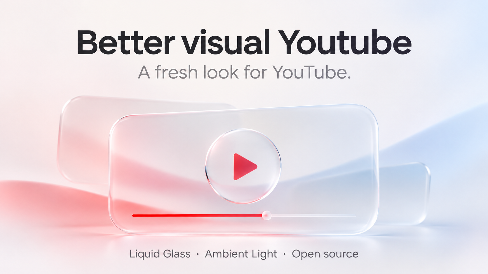

## A fresh look for YouTube

The first public beta of Better visual Youtube is here, for Microsoft Edge and Google Chrome on desktop.

- **Liquid Glass:** transparent surfaces and light-catching edges across the interface.
- **Ambient Light:** colour that extends beyond the video.
- **Your settings:** themes, glass effects and animations in one panel.

Download **Better-visual-Youtube-0.4.53.zip** below, extract it, and load the folder through your browser's extensions page. [Installation guide](https://github.com/Moments2505/better-visual-youtube/blob/v0.4.53/INSTALL-EN.md).

This is an early release, and some interactions may still stutter. Feedback and bug reports are welcome in [Issues](https://github.com/Moments2505/better-visual-youtube/issues).

## Một diện mạo mới cho YouTube

Better visual Youtube đã có bản beta công khai đầu tiên, dành cho Microsoft Edge và Google Chrome trên máy tính.

- **Liquid Glass:** lớp kính trong và viền bắt sáng trên giao diện.
- **Ambient Light:** ánh sáng mở rộng từ màu sắc trong video.
- **Tuỳ chỉnh:** giao diện, hiệu ứng kính và chuyển động trong cùng một bảng cài đặt.

Tải **Better-visual-Youtube-0.4.53.zip** bên dưới, giải nén và nạp thư mục qua trang quản lý tiện ích. [Hướng dẫn cài đặt](https://github.com/Moments2505/better-visual-youtube/blob/v0.4.53/INSTALL-VI.md).

Đây là bản phát hành đầu tiên; một số thao tác vẫn có thể bị giật. Bạn có thể gửi góp ý hoặc báo lỗi tại [Issues](https://github.com/Moments2505/better-visual-youtube/issues).
