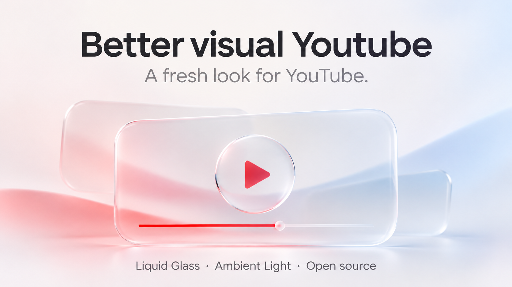

## More control over the interface

This beta brings together the updates since 0.4.53:

- **Wheel controls:** scroll over a settings slider to adjust it.
- **Hover switch:** turn hover effects off without disabling other animations.
- **Transparency choice:** keep glass transparent, or follow the system's reduced-transparency preference. Solid surfaces follow YouTube's appearance for readable text.
- **Panel handoffs:** video details, comments and recommendations select hover using their original bounds, with the selected panel above panels that are shrinking.
- **Optional feedback:** removing the extension opens an English/Vietnamese page asking what could be better. Answers stay on the page until the user chooses to copy them or open an email draft.

[Full changelog](https://github.com/Moments2505/better-visual-youtube/blob/v0.4.58/CHANGELOG.md) · [Installation and updates](https://github.com/Moments2505/better-visual-youtube/blob/v0.4.58/INSTALL-EN.md) · [Report an issue](https://github.com/Moments2505/better-visual-youtube/issues)

Download **Better-visual-Youtube-0.4.58.zip** below. To update, replace the files in the extension's existing folder, reload it in your browser, then reload YouTube. Saved preferences are retained.

Still a beta: automated checks cover source behaviour, not browser frame rate. Wider feedback on smoothness is welcome.

---

## Thêm tùy chỉnh cho giao diện

Bản beta này tổng hợp các thay đổi từ 0.4.53:

- **Con lăn:** rê lên slider trong bảng cài đặt để tăng/giảm giá trị.
- **Công tắc hover:** tắt hover riêng, vẫn giữ các chuyển động khác.
- **Tùy chọn độ trong:** giữ kính trong suốt hoặc theo thiết lập giảm độ trong suốt của hệ thống. Khi dùng nền đặc, màu nền theo giao diện YouTube để chữ dễ đọc.
- **Chuyển giữa panel:** chi tiết video, bình luận và đề xuất nhận hover theo khung gốc; panel vừa chọn nằm trên panel đang thu lại.
- **Góp ý khi gỡ:** mở trang hỏi đáp Anh/Việt, cho chọn lý do và viết điều chưa hài lòng. Người dùng tự chọn sao chép nội dung hoặc mở bản nháp email; không tự gửi câu trả lời.

[Changelog đầy đủ](https://github.com/Moments2505/better-visual-youtube/blob/v0.4.58/CHANGELOG.md) · [Cài đặt và cập nhật](https://github.com/Moments2505/better-visual-youtube/blob/v0.4.58/INSTALL-VI.md) · [Báo lỗi](https://github.com/Moments2505/better-visual-youtube/issues)

Tải **Better-visual-Youtube-0.4.58.zip** bên dưới. Để cập nhật, thay các tệp trong thư mục extension đang dùng, bấm Reload trên trang tiện ích rồi tải lại YouTube. Các cài đặt đã lưu được giữ lại.

Đây vẫn là bản beta. Kiểm tra tự động bao phủ logic mã nguồn, chưa đo FPS thực tế; góp ý về độ mượt luôn được hoan nghênh.
